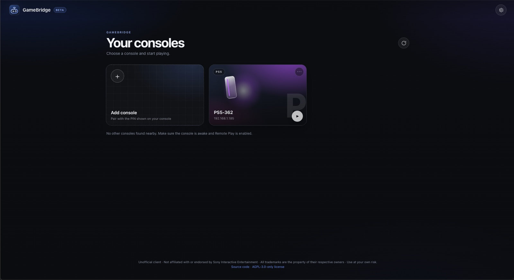
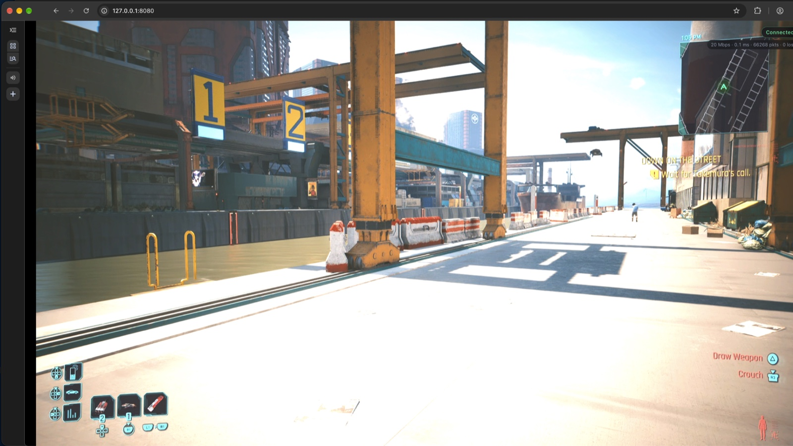
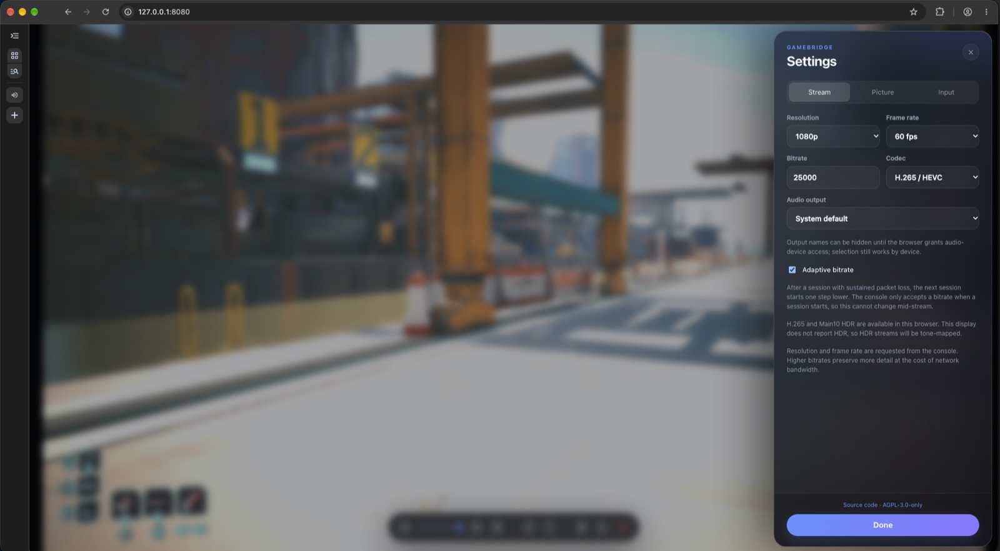
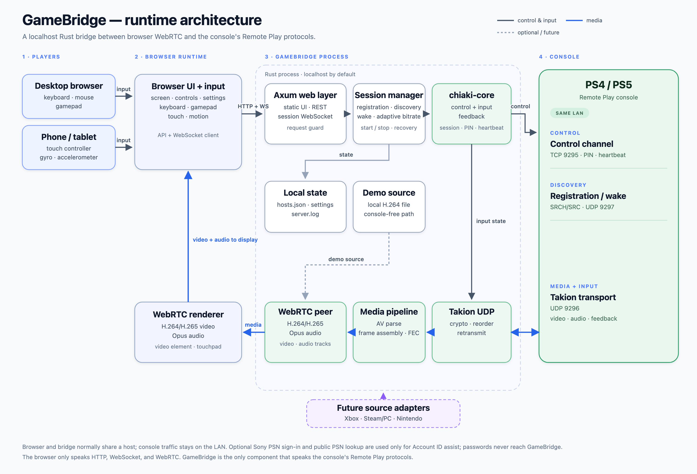

# GameBridge

**Your console, in your browser.**

> **Unofficial.** GameBridge is not affiliated with, endorsed by, or sponsored by
> Sony Interactive Entertainment. PlayStation, PS4, PS5, PSN, and Remote Play
> are trademarks of Sony Interactive Entertainment. Use at your own risk; see
> [Terms and risk](#terms-and-risk).

GameBridge is an unofficial, browser-based game-streaming bridge, currently
focused on PlayStation Remote Play. It is a Rust reimplementation of the
protocol, packaged as a localhost web server that streams a PS4 or PS5 into any
browser over WebRTC.

**Works today:** PS4 and PS5 Remote Play on your local network. Xbox, Steam,
and Nintendo are future plans; see [Roadmap](#roadmap).

Browsers cannot open the raw UDP sockets Remote Play requires, so this project
bridges the console protocol to the browser:

```
Browser  ── HTTP + WebSocket ──▶  gamebridge  ── TCP/UDP ──▶  Console
   ▲                                  │
   └────── WebRTC (H.264/H.265 + Opus) ◀──┘
```

The server owns registration, discovery, session negotiation, the Takion UDP
transport, FEC, and input; the browser only renders WebRTC tracks and sends
controller input over the WebSocket.

This is a from-scratch Rust port of the protocol implemented by
[Chiaki](https://git.sr.ht/~thestr4ng3r/chiaki) v2.2.0. It is licensed
AGPL-3.0-only; see [Licensing](#licensing).

## Terms and risk

GameBridge is an unofficial client. Using it may violate Sony's PlayStation Network
terms of service or your console's Remote Play terms. You are responsible for
complying with them. Console bans, account restrictions, firmware changes that
break the protocol, and any other consequences are your own risk. The software
is provided under the AGPL without warranty; see [Licensing](#licensing).

This project does not include or redistribute Sony software, SDK headers,
firmware, artwork, or keys extracted from Sony software by this project. See
[Provenance and legal posture](#provenance-and-legal-posture).

## Provenance and legal posture

- This is a from-scratch Rust port of the protocol implemented by Chiaki
  v2.2.0. Chiaki has been public since 2019 under AGPL-3.0-only-OpenSSL.
- The protocol key tables in
  `crates/chiaki-core/src/crypto/rpcrypt_keys.rs` and the PSN OAuth client
  constants in `crates/server/src/psn.rs` originate from Chiaki's public AGPL
  source. They were not extracted from a Sony SDK, firmware, or decompiled Sony
  software by this project.
- No Sony binaries, SDK headers, firmware dumps, or artwork are distributed.
- The project is permanently AGPL-3.0-only as a Chiaki derivative and cannot be
  relicensed permissively.

## What works

- Console registration, discovery (SRCH/SRC2/SRC3), and wake-on-LAN. Starting
  a session automatically wakes a console in Rest Mode and waits for it before
  connecting; the console type is inferred from the SRC response (with unicast
  detection for a manually entered IP)
- Session request with RP-Version negotiation (PS4 8.0/9.0/10.0, PS5 1.0)
- Ctrl channel: session id, console PIN login, heartbeat, standby (`goto bed`)
- Takion transport: handshake, RPCrypt/GKCrypt, GMAC, reordering, retransmit
- H.264 or H.265 video (including experimental HDR) and Opus audio with
  Reed–Solomon FEC, gap detection, and IDR resync
- WebRTC delivery with non-trickle ICE (loopback or LAN), plus automatic ICE
  restart and WebSocket reconnection when the link drops
- Senkusha pre-stream probing on UDP 9297 for MTU and RTT; the measured RTT is
  shown in the stream stats and the MTU sizes the launch spec and fragmentation
- Gamepad, keyboard/mouse, and touch input; persistent rumble state; latency,
  packet, and video-queue stats. Latency is the round-trip time to the
  console: measured by Senkusha at stream start, then updated from the
  console's own connection-quality reports.
- Optional experimental DualSense feedback (**Settings → Input**): rumble plus
  a `trigger-rumble` approximation of adaptive-trigger effects. Full effect
  modes would need WebHID; see [Limitations](#limitations).
- Phone/tablet play with an auto-shown on-screen controller (dual sticks,
  D-pad, face buttons, shoulders/triggers, and menu buttons) and optional
  device gyro/accelerometer motion with a Recenter control.
- Screenshot, local pause/resume, keyframe resync, and console Rest Mode in the
  player bar. Pausing freezes this view only; the console keeps running.
- After a console standby disconnect, **Wake and resume** wakes it from Rest
  Mode and starts a new session without leaving the player view.
- Volume and mute controls in the player bar, saved per browser; **M** toggles
  mute while streaming. **Settings → Stream → Audio output** selects a speaker
  on browsers that support `setSinkId` (Chromium-based).
- Configurable keyboard binding profiles, saved per browser and switchable
  under **Settings → Input**.
- Cross-session adaptive bitrate: sustained packet loss steps the next
  session's starting bitrate down; clean sessions step it back up.
- Demo mode that streams a built-in or local H.264 clip with no console
  attached

Deferred/unsupported (see [Limitations](#limitations)): PSN cloud streaming,
DualSense haptics and full adaptive-trigger modes, keyboard text entry,
multi-controller, and microphone input. Remote binds require `--allow-remote`;
optional token auth is covered under
[LAN access and authentication](#lan-access-and-authentication).

## Quick start

**Try it without a console.** The built-in demo needs no console, PSN account,
or ffmpeg:

```sh
gamebridge --demo
```

Open <http://127.0.0.1:8080/> and press **Start demo stream**. A test pattern
appears and the stats overlay updates live, which verifies the browser and
WebRTC path.

**Play a console.** PS4 or PS5 Remote Play on the same LAN:

1. Run `gamebridge` and open <http://127.0.0.1:8080/>.
2. Choose **Add console** and follow
   [Registering a console](#registering-a-console).
3. Enter a PSN Account ID only if the console asks for one; it is not needed
   for every registration.
4. Press **Play**, and enter the PIN shown on the console if it asks.

Phones/tablets need a secure context; see
[LAN access and authentication](#lan-access-and-authentication). Known
limitations are under [Limitations](#limitations).

## Screenshots

| Home screen | In-game |
| --- | --- |
|  |  |



Game imagery is from *Cyberpunk 2077*, © CD Projekt Red; shown for illustration.

## Requirements

- Rust 1.97 or newer (edition 2024)
- A PS4 or PS5 on the same LAN with **Enable Remote Play** turned on
  (Settings → System → Remote Play)
- Your **PSN Account ID**, if your console asks for one. This is the numeric
  account ID from PSN account info, not your PSN username. Enter it as a
  decimal number (converted to Sony's 8-byte little-endian form automatically),
  a hex value, or an existing base64 Account ID. You can also paste a PSN
  redirect URL/code in the Add console panel to fetch it automatically. It is
  saved on this device for later registrations. PS4 system software older than
  7.0 can use the PSN Online ID instead.
- A browser with H.264 support in WebRTC (Chrome, Edge, Safari, Firefox).
  H.265 is optional and additionally requires a PS5 plus hardware HEVC decode
  exposed over WebRTC (Chrome 136+ or Safari 18+ on supported hardware;
  Firefox and current Edge do not offer it).

## Install and run

Prebuilt binaries for macOS (Apple Silicon and Intel), Linux x86_64, and
Windows x86_64 are published on the
[Releases](https://github.com/rahuljaguste/gamebridge/releases) page. Extract the
archive and run `gamebridge` (or `gamebridge.exe`). The macOS binaries are unsigned; the
release notes cover the Gatekeeper and SmartScreen prompts. Each release also
includes `gamebridge-<version>-source.tar.gz`, the exact AGPL-3.0-only
Corresponding Source for those binaries.

### Build from source

```sh
cargo build --release
./target/release/gamebridge
```

Then open <http://127.0.0.1:8080/>.

The server handles both `Ctrl+C` and `SIGTERM`. If a session is active, it asks
the console to stop before exiting, which matters when it runs under systemd,
launchd, or a Docker stop.

Options:

| Flag | Default | Meaning |
| --- | --- | --- |
| `--bind <addr>` | `127.0.0.1:8080` | Address for the web UI. Non-loopback addresses are refused unless `--allow-remote` is also given. |
| `--allow-remote` | off | Permit a non-loopback bind. Without an auth flag this mode is unauthenticated. |
| `--trust-proxy` | off | Trust `X-Forwarded-Proto` from a reverse proxy. Enable only when the server is reachable exclusively through that proxy; marks the session cookie `Secure` when the proxy reports HTTPS. |
| `--auth-token <token>` | — | Require this token for API and WebSocket access. |
| `--auth-token-file <path>` | — | Read the access token from a file (keeps it out of `ps` output). |
| `--config-dir <dir>` | platform config dir | Override where `hosts.json` is stored. |
| `--demo` | off | Stream a built-in test pattern with no console and no demo file. |
| `--demo-file <file>` | — | Enable the demo endpoint with a local Annex-B H.264 stream. |
| `--video-queue <frames>` | `16` | Frames buffered between ingest and the WebRTC writer (2–64). Higher absorbs writer stalls but adds up to frames/fps of display latency. |
| `--log-file <path>` | `<config dir>/server.log` | Also write logs to this file (stderr always gets them too). |

The configuration directory is `$XDG_CONFIG_HOME/gamebridge` (or the
platform equivalent, e.g. `~/Library/Application Support/gamebridge` on
macOS). `GAMEBRIDGE_CONFIG_DIR` overrides it, as does `--config-dir`. The
legacy `SETU_CONFIG_DIR` variable is still accepted. It is created with mode
`0700`, and `hosts.json` with mode `0600`, because it contains console
registration keys. On first run, a `hosts.json` from the previous `setu`
directory is copied into `gamebridge` automatically; if that is absent, the
older `ps-remoteplay` directory is used. The old directories are left
untouched.

## Limitations

**At a glance:** one Remote Play session per console; a started session stops
if the browser does not connect within 30 seconds; H.265/HDR depend on console
and browser support, and HDR plus phone motion are experimental; Wi-Fi loss and
local video backpressure both cause frame drops and keyframe waits; wake from
Rest Mode depends on the stored registration key; PS5 support is protocol 1.0
only.

- **H.265 depends on the console and the browser.** PS4 sessions are H.264
  only. PS5 can deliver H.265, but the browser must expose hardware HEVC over
  WebRTC (Chrome 136+ or Safari 18+; Firefox and current Edge do not). HDR
  also requires Main10 hardware decode and an HDR display. If the browser's
  answer does not accept the offered codec, the start fails with a clear error
  instead of running a stream that never displays.
- **Adaptive bitrate cannot retarget a live stream.** The launch spec fixes
  the console encoder's bitrate for the whole session, and the protocol has no
  mid-session command to change it. GameBridge adapts the next session's starting
  bitrate from measured loss. It does not drop or re-encode frames to fake a
  lower live rate.
- **PS5 support is protocol 1.0 only**, matching Chiaki v2.2.0. Newer console
  firmware may change or reject the handshake.
- **No PSN cloud streaming.** Local-console Remote Play is supported; PSN cloud
  sessions are not. Senkusha probing itself is implemented and runs before each
  local stream.
- **DualSense support is experimental and partial.** Rumble is supported. With
  **Settings → Input → DualSense feedback** enabled, the console sends
  trigger-effect data and GameBridge maps it to Chrome's `trigger-rumble`
  approximation; full adaptive-trigger modes would need WebHID. Haptics,
  touchpad gestures beyond basic touches, and the DualSense microphone are not
  forwarded. The experimental mode may make the console's streaming server
  unstable after repeated sessions.
- **Keyboard text entry** from the console is consumed but not surfaced in the
  browser.
- **Phones/tablets need a secure context for full support.** Plain
  `http://` on a LAN IP can block WebRTC, the Gamepad API, and motion sensors in
  mobile browsers. Use `localhost` (Android port forwarding), or an HTTPS
  reverse proxy with a certificate trusted by the device. Built-in TLS is not
  included yet.
- **Phone motion is experimental.** Gyro/accelerometer axis signs depend on the
  device and grip. Recenter corrects the current heading but not axis mapping;
  verify on your hardware and adjust the single sign constant in
  `motion-math.js` if needed.
- **iOS fullscreen limitation.** iPhone Safari does not support Element
  Fullscreen, so the Fullscreen button may be unavailable there; use landscape
  or Add to Home Screen. Elsewhere the whole page enters fullscreen, keeping
  Settings, PIN, authentication, and stream dialogs visible. Only Stop or an
  explicit Exit fullscreen action leaves fullscreen.
- **One active session** at a time and **localhost only** by default. Remote
  binds require `--allow-remote`, and should use `--auth-token` or
  `--auth-token-file` on any network with devices you do not control. There is
  one shared token, not per-user accounts. A started session waits 30 seconds
  for the browser's WebRTC peer and stops itself if it never connects (for
  example, if the tab died before answering).
- Release builds unwind panics. The session-manager task is supervised: a
  panic is logged, the active slot is cleared, and the browser receives a
  session-ended event instead of the process wedging or exiting. Run it under a
  process supervisor for unattended use; `SIGTERM` shuts down cleanly and
  closes upgraded WebSockets.
- The `/api/psn/*` account-ID helper endpoints use Sony's legacy Remote Play
  OAuth client and may stop working if Sony changes those endpoints, just like
  Chiaki's helper. **Get a code** and redirect-code exchange use them; the PSN
  password is never sent to GameBridge.
- Video is forwarded as complete access units; a lost slice or a frame that
  fails FEC is dropped and the client requests a new IDR. Expect a short
  recovery hitch under heavy packet loss.
- **Framerate drops have two distinct causes.** Packet loss makes FEC fail and
  forces keyframe waits. Local backpressure — HDR/H.265 decode, a backgrounded
  tab, or a busy CPU — overflows the video queue and drops frames even
  when the network is clean. The log distinguishes them: `FEC failed` is
  network, `video queue full` is backpressure. A queue overflow also requests a
  new IDR, so one hiccup can extend itself. The queue is tunable with
  `--video-queue <frames>` (default 16): lower it for less display latency,
  raise it for more stall tolerance. The HUD shows its depth and peak.
- Audio is Opus as sent by the console; no transcoding or volume normalization.
- The console may refuse a stream while another Remote Play client (including
  the official app) is connected.

## LAN access and authentication

The bridge is loopback-only and unauthenticated by default. To let other
devices on the LAN use it, bind a LAN address and pass `--allow-remote`:

```sh
gamebridge --bind 0.0.0.0:8080 --allow-remote
```

When bound to a LAN address or `0.0.0.0`, the server prints the reachable LAN
URLs and a scannable QR code in the startup banner. When bound to loopback, it
prints the command needed to enable LAN access instead.

That mode is open to anyone who can reach the port: they can start and stop
streams, send controller input, and delete registrations. To require a token,
create one and pass it at startup:

```sh
openssl rand -base64 32 > gamebridge.token
chmod 600 gamebridge.token
gamebridge --bind 0.0.0.0:8080 --allow-remote --auth-token-file gamebridge.token
```

The first visit asks for the token and exchanges it for an `HttpOnly`,
`SameSite=Strict` cookie containing a random, server-side session id. The
cookie lasts 30 days; **Lock** revokes that session immediately. Scripts can
use `Authorization: Bearer <token>` instead. Every API route except the auth
endpoints, and the session WebSocket, are gated; the static UI shell stays
public so the unlock screen can load. Failed API authentication is delayed,
and repeated failures from one address slow down further. Authentication is
off when neither auth flag is given. Restarting the server invalidates
existing sessions.

This is authentication, not transport security. Plain HTTP on Wi-Fi still
exposes the token and controller input to a passive sniffer; use a trusted
network or put the bridge behind an HTTPS reverse proxy, and pass
`--trust-proxy` so the login cookie is marked `Secure`. One token is shared by
all clients; there are no per-user accounts. The server warns at startup when
it serves remote clients over plain HTTP.

A local reverse proxy also gives phones/tablets the secure context needed for
WebRTC, Gamepad, and motion sensors. For example, keep GameBridge bound to the
LAN with `--allow-remote --trust-proxy` and proxy to it with Caddy so the
original `Host` and `Origin` are preserved:

```caddyfile
gamebridge.lan {
    reverse_proxy 127.0.0.1:8080
}
```

`--trust-proxy` honors `X-Forwarded-Proto` (Caddy sends it by default) and marks
the session cookie `Secure` when the proxy reports HTTPS. Enable it only when
the server cannot be reached except through the proxy; otherwise a client that
connects directly can spoof the header. Use a certificate the
device trusts (Caddy's internal CA installed on the phone/tablet, `mkcert`, or a
public certificate for a real hostname). The default port 443 is supported after
the guard's HTTPS-default-port fix. There is no built-in TLS listener yet.

## Using the UI

The home screen shows your consoles as tiles. **Add console** is the first tile;
paired consoles follow, then consoles discovered on your network. Choose a
paired tile to play, or choose a **Nearby** tile to pair that console. Each
paired tile has a **⋯** menu with **Wake** and **Remove**. The gear
button in the top-right opens **Settings** in a glass panel that slides in from
the right; the lock button beside it appears when authentication is enabled.
The refresh button at the right of the **Your consoles** heading rescans the
network. Settings has three tabs: **Stream**, **Picture**, and **Input**.

**Add console** also opens as a non-modal glass panel from the right. On first
load, if no paired or nearby consoles are found, it opens automatically.
Console type is shown as a radio group, the **Name** field is optional, and
**?** buttons beside the address and PIN fields explain where to find each
value. Context messages and session notices appear as toasts in the
bottom-right.

While streaming, the video fills the window. On desktop, move the mouse or tap
the video to show the floating bar: mute/volume, pause, screenshot, resync,
fullscreen, settings, rest mode, and stop. The bar auto-hides after a few
seconds. **Resync** asks the console for a fresh keyframe if the picture
stalls; **Rest mode** puts the console to sleep and ends the stream; **Stop**
returns to the home screen. On touch-capable devices the bar also toggles the
on-screen controller.

### Keyboard and mouse

**Settings → Input → Keyboard profile** lists every action and lets you remap
or clear it. Defaults include Space (Cross), J/K/L (Moon/Box/Pyramid), Q/E
(L1/R1), Z/C (L2/R2), WASD (left stick), Enter (Options), Backspace (Share),
Tab (Touchpad), and **P (PS/Home)**. P sends the console's PS/Home button — the
same one you use to leave a game — without a controller. With pointer lock the
mouse drives the right stick; left click is R2 and right click is L2. Bindings
only act while a stream is live and never while a text field or dialog has
focus.

### Phones and tablets

Touch devices get an on-screen controller automatically. A dedicated **Menu**
button at the bottom centre opens a full stream menu with pause/resume, volume,
mute, screenshot, resync, settings, fullscreen, controls, rest mode, and stop.
The **Controls** action and **Settings → Input → Touch controls** persist the
choice. The desktop player bar is intentionally hidden during touch streaming,
so it cannot cover a stick or button in fullscreen. The layout is
landscape-first; in portrait the controls are hidden and a rotate hint appears
while the stream keeps running.

The video remains a two-finger touchpad in empty areas. **Settings → Input →
Motion controls** enables phone gyro/accelerometer input; iPhone and iPad ask
for sensor permission when you enable it or start the first session. Use
**Recenter** in the on-screen menu (or Settings) to zero the current heading
without changing tilt. Motion axes are experimental and may need a sign
adjustment on some devices.

Android Chrome via `adb reverse tcp:8080 tcp:8080` and `http://localhost:8080`
gives a secure context for testing. For other devices, use an HTTPS reverse
proxy with a certificate the phone/tablet trusts; see the LAN section below.
GameBridge does not include a TLS listener yet. Plain HTTP to a LAN IP may show
an insecure-connection warning and may block WebGL/Gamepad/sensor access or
WebRTC depending on the browser.

## Registering a console

1. On the console, open the Remote Play pairing screen and note the PIN.
   **PS5:** Settings → System → Remote Play → Link Device. **PS4:** Settings →
   Remote Play Connection Settings → Add Device.
2. On the GameBridge home screen, choose **Add console** (or choose a **Nearby** tile
   for a console that appeared automatically). In the panel, enter the console
   address and wait for **Detect** to read the SRC discovery response. The
   matching console-type radio is selected automatically; choose one manually
   if detection fails.
3. Enter the PIN. If the console asks for a PSN Account ID, enter it in the
   visible **PSN account** section, paste a PSN redirect URL/code, or use the
   optional **Public Lookup** by PSN Online ID. To get a redirect code, choose
   **Get a code** beside **PSN redirect URL or code**, sign in with the PSN
   account that owns the console, then copy the entire URL from the final
   redirect page — it may look blank or show an error, but still contains
   `?code=…`. Public Lookup uses the third-party `psn.flipscreen.games` service
   and requires the PSN privacy setting that lets anyone find you in search.
   The fetched Account ID is saved on this device. Press **Add console**.
4. If unicast detection or a direct registration request is rejected, enable
   **Search by broadcast** in the **PSN account** section and retry.
5. The console appears on the home screen; press **Play** to start streaming.

The registration PIN is a one-time pairing code and is **not** stored. What
pairing produces — the console's RegistKey, RP-Key, MAC and nickname — is saved
in `hosts.json` and reused for every later session, so you do not pair again.

If the console asks for a PIN when starting a stream, that is a **session login
PIN** generated by the console and displayed on it; it changes per request and
cannot be reused or saved. Enter it in the in-page modal. (Its wording says
"console login", not registration.)

## Demo mode

`gamebridge --demo` streams a built-in H.264 test pattern through the same
WebRTC bridge, with no console attached. Open the UI and press **Start demo
stream** (or `POST /api/demo/start`). The clip loops until you stop it; stats
update live.

To use your own clip, any Annex-B H.264 elementary stream works. The bridge
splits access units on AUD NALs, so make sure ffmpeg emits them:

```sh
ffmpeg -f lavfi -i testsrc=size=1280x720:rate=30 -t 20 \
       -c:v libx264 -profile:v baseline -pix_fmt yuv420p \
       -x264-params aud=1 -f h264 demo.h264

gamebridge --demo-file demo.h264
```

## Video quality

- **Bitrate** is the main lever; it lives under **Settings → Stream**. Presets
  use 10 Mbps at 720p and 15 Mbps at 1080p; try 20000–30000 for 1080p. Higher
  bitrate preserves detail and motion sharpness at the cost of Wi-Fi/network
  bandwidth. Leave the field empty to use the preset value.
- **Adaptive bitrate** (on by default) records packet loss after a 5-second
  warm-up and, at session end, moves the next start one rung down the
  3/5/7/10/15/20/25/30 Mbps ladder when loss averaged at least 1.5%, or when
  any one-second window reached 5% (burst loss). Two sessions below 0.3%
  average and 1% peak move it back up. The launch spec fixes the encoder
  rate for the life of a session and the protocol has no retarget command, so
  this takes effect on the **next** connection, not mid-stream. The live stats
  show the current loss estimate, and the server tells you when the next start
  will change. State is stored per console in `hosts.json`; changing the manual
  bitrate resets the stored step.
- **Codec** is under **Settings → Stream**. H.264 is the compatible default.
  H.265/HEVC can roughly halve bandwidth at similar quality on a PS5 when the
  browser has hardware HEVC in WebRTC; HDR additionally needs Main10 decode and
  an HDR display. GameBridge feature-detects HEVC and leaves the options disabled when the
  browser does not advertise it. The server verifies that the browser's SDP
  answer actually accepted the offered codec before the stream starts.
- **Sharpness** (0–100, default 35; **Settings → Picture**) runs a two-pass
  WebGL2 post-process over the received video: FSR 1 **EASU** reconstructs the
  frame at the display's native pixel grid (up to a 4K target), then **RCAS**
  sharpens it in linear light. It adds no bandwidth and works on any GPU,
  including integrated and Apple Silicon. Set it to 0 to disable sharpening;
  the color controls below still apply.
- **Brightness / Contrast / Saturation** (each −100–100; defaults +15/+20/+20;
  **Settings → Picture**) are graded in linear light inside the same pass.
  Brightness is exposure in ±1.5 EV, contrast pivots around middle gray, and
  saturation mixes around Rec.709 luma. **Reset picture** restores the defaults.
  Set every picture control to neutral (Sharpness 0,
  Brightness/Contrast/Saturation 0, Temporal 0) to bypass the post-process
  entirely and display the WebRTC video directly. All values are stored per
  browser.
- **Temporal** (0–100, default 0; **Settings → Picture**) adds contrast-adaptive
  temporal accumulation before RCAS. It clamps the previous frame to the
  current 3×3 neighbourhood and reduces the blend where the correction is
  large, which settles compression shimmer and specular aliasing without
  motion-vector smearing at scene cuts. There are no engine motion vectors in a
  decoded stream, so very fast motion can still ghost slightly; raise it
  gradually.
- Sharpening cannot recover detail the console encoder discarded — pair it with
  a suitable bitrate. Resolution and FPS are encoded on the console and are
  requested under **Settings → Stream**. Keyboard bindings and profile
  management are under **Settings → Input**; each key can be rebound, cleared,
  or reset, and profiles can be created, selected, reset, and deleted. They are
  stored in this browser.

## Configuration and privacy

- The server binds to `127.0.0.1` by default and refuses a non-loopback bind
  unless `--allow-remote` is passed. Without `--auth-token` or
  `--auth-token-file`, that mode has no authentication, so only enable it on a
  network you trust. There is no TLS; see
  [LAN access and authentication](#lan-access-and-authentication).
- Loopback alone is not an origin boundary, so every request must carry a
  loopback `Host` (plus the bind address if you deliberately bind elsewhere).
  When a browser sends `Origin`, it must be this server's own loopback origin.
  This blocks cross-site WebSocket control and DNS-rebinding attacks against
  the JSON API.
- Console regist keys and keys are stored locally in `hosts.json`. Treat that
  file as a credential.
- If you enter or auto-fill a PSN Account ID in the browser, it is saved in
  that device's `localStorage` (`gamebridge.psnAccountId`) so later registrations can
  reuse it. It is not written to `hosts.json`; the bridge receives it only in
  the registration request. Use **Forget** next to the field to remove it.
- Streaming, registration, and discovery traffic goes only to the console
  (TCP 9295, UDP 9296, and Senkusha UDP 9297) and the local network
  (UDP 987/9302). Two optional lookups are external: pasting a PSN redirect
  URL/code exchanges that one-time code with Sony's account service, and
  **Public Lookup** sends the entered PSN Online ID to `psn.flipscreen.games`
  (the third-party lookup used by chiaki-ng). The PSN password is never handled
  by GameBridge. Use Public Lookup only if you are comfortable with that request and
  your PSN privacy setting allows public search. The **Get a code** link uses
  `/api/psn/login` to open Sony's sign-in page; the code is only used to fetch
  the Account ID and is not stored.

## Architecture

### Runtime topology



Full-resolution image: [PNG](docs/architecture.png) · [SVG source](docs/architecture.svg)

The browser only speaks HTTP, WebSocket, and WebRTC. GameBridge is the only
component that speaks the console's Remote Play protocols, and console traffic
stays on the LAN. The browser and GameBridge normally run on the same machine;
for remote play over a LAN, the server is the opt-in boundary protected by
`--allow-remote` plus optional token authentication. Optional PSN calls are the
only external requests.

### Code layout

```
crates/chiaki-core/
  crypto/      RPCrypt (AES-128-CFB), GKCrypt (AES-128-ECB + GMAC), ECDH
  regist.rs    registration payload + SRC search + HTTP POST
  discovery.rs discovery/wakeup packets
  session.rs   session request, supervisor, event/command channels
  ctrl/        control TCP channel (session id, PIN, heartbeat)
  takion/      UDP transport: handshake, MAC, reorder queue, retransmit
  stream/      launch spec, protobuf messages, stream connection
  media/       AV parsing, frame assembly, Cauchy Reed–Solomon FEC, audio
  feedback.rs  controller state/history encoding
crates/server/
  routes/      JSON API, WebSocket input/events, static UI
  webrtc/      peer setup, H.264/Opus bridges, IDR gating
  config.rs    persistent host store
  demo.rs      console-free H.264 demo path
```

The core uses one owner per stateful protocol object with bounded channels and
cancellation tokens; there are no shared protocol mutexes.

## Testing

```sh
cargo test --workspace
cargo clippy --workspace --all-targets -- -D warnings
cargo fmt --all -- --check
node --check crates/server/src/static/app.js
node --check crates/server/src/static/motion-math.js
node --test tools/test_motion_math.js
```

The suite includes Chiaki's known-answer vectors for RPCrypt, GKCrypt, GMAC key
refresh, ECDH, FEC, and a captured AV packet, plus an end-to-end mock console
that exercises session → ctrl → Takion → encryption → launch spec → stream info
→ video/audio → clean stop.

## Troubleshooting

- **Registration fails with a direct request**: use **Search by broadcast**, and
  verify the console type (PS4 pre-8.0 uses a different registration path).
- **PIN prompt never appears**: the console shows the PIN dialog when a session
  starts; if you miss it, stop and start the session again.
- **Black video / no frames**: check the log for `detected missing/corrupt
  frames` or FEC failures. The bridge requests an IDR after a gap; if the
  console does not send one, stop and restart the stream.
- **Picture stutters or the framerate drops**: check the log. Repeated
  `video queue full` means the browser is not draining the stream fast enough:
  lower the bitrate, switch to H.264, keep the tab visible, and close CPU-heavy
  apps. Repeated `FEC failed` or `got an old frame packet` means network
  loss/jitter: prefer wired Ethernet or a stronger Wi-Fi link. The in-stream
  HUD shows `queue depth/capacity`; a depth that stays high, or a peak near the
  capacity, confirms backpressure. Lower `--video-queue` for less display
  latency.
- **No audio in Safari**: Safari requires the page to be interacted with before
  starting audio; click the page once, then start the stream.
- **PS button opens the macOS Games app**: macOS reserves the controller
  Home/PS button before the browser sees it. When the server runs on macOS,
  GameBridge can change this from **Settings → Input → Reserve the controller
  PS button for GameBridge**. Alternatively, use **System Settings → Game
  Controllers → Controller Shortcuts** to disable the shortcut, or on macOS 27+
  add Chrome/Safari to the per-app Home Button Overrides. Terminal alternative:

  ```sh
  defaults write com.apple.GameController bluetoothPrefsMenuLongPressAction -integer 0
  ```

  Then log out and back in. Once macOS stops consuming the button, GameBridge
  receives it as Gamepad API button 16. To restore the macOS behavior, delete
  the key with `defaults delete com.apple.GameController
  bluetoothPrefsMenuLongPressAction`.
- **Console not found by Scan**: discovery uses UDP broadcast; some networks
  block it. Register by IP instead.
- **“Remote Play on Console has crashed” (0x80108b15)**: this is the console's
  own Remote Play server crashing, not a pairing failure; the official app
  fails the same way until it restarts. Put the console into rest mode and
  wake it again (the **Wake** button in the console list), or restart it.
  Leave **DualSense feedback (experimental)** off: extended DualSense features
  are a known trigger for this PS5 crash.

Registration failures include the console's HTTP status and `RP-Application-Reason`
(for example "Regist failed, probably invalid PIN"). The same details are written
to `server.log` in the configuration directory, alongside stderr.

If you enable WebRTC logs (`RUST_LOG=rtc=warn`), you may see
`IceHandler.handle_read got error: password is empty` and DTLS "Unsupported
Extension"/mDNS warnings. They come from the first STUN checks arriving before
the browser's answer is installed in non-trickle signaling and are harmless;
they are hidden at the default log level.

Set `RUST_LOG=debug` (or `RUST_LOG=chiaki_core=debug`) for protocol-level logs.

## Roadmap

GameBridge currently supports PS4 and PS5. The long-term goal is one
self-hosted browser bridge for multiple game sources, not a PlayStation-only
tool.

- **Now — PlayStation:** PS4/PS5 registration, session negotiation, H.264/H.265
  (including HDR where supported), Opus audio, FEC, input, auto-wake, and
  cross-session adaptive bitrate.
- **Next — Xbox:** investigate Xbox remote/console streaming and add support
  when the protocol, platform terms, and hardware testing allow. Xbox is not
  implemented yet.
- **Planned — Steam/PC:** add a Steam/PC streaming source so the same browser
  client can play games running on a local PC.
- **Exploring — Nintendo:** evaluate Nintendo console streaming where feasible;
  no support is committed.
- **Platform work:** multi-source console management, per-source capability
  detection, multi-user/session isolation, TLS/reverse-proxy deployment, and
  signed installers.

These are directions, not delivery dates. Support depends on protocol access,
platform terms, hardware testing, and maintainer time. GameBridge is unofficial
and is not affiliated with Sony, Microsoft, Nintendo, or Valve.

## Licensing

GameBridge is Copyright (C) 2026 Rahul Pramod Jaguste and contributors.

This program is free software: you can redistribute it and/or modify it under
the terms of the GNU Affero General Public License, version 3 only, as
published by the Free Software Foundation. See [COPYING](COPYING).

It is a derivative work of **Chiaki v2.2.0** (AGPL-3.0-only-OpenSSL),
Copyright (C) the Chiaki contributors, and includes protocol structures and
cryptographic key tables generated from that source. Chiaki:
<https://git.sr.ht/~thestr4ng3r/chiaki>. The project is permanently
AGPL-3.0-only as a Chiaki derivative and cannot be relicensed permissively.

The browser sharpening pass is ported from **AMD FidelityFX Super Resolution
1.0** (EASU and RCAS), Copyright (c) 2021 Advanced Micro Devices, Inc.,
released under the MIT licence. See [THIRD_PARTY_NOTICES.md](THIRD_PARTY_NOTICES.md)
for Chiaki, AMD FSR, and other attributions. A generated inventory of
dependency licenses is in [THIRD_PARTY_LICENSES.md](THIRD_PARTY_LICENSES.md).

If you run a modified version of this program as a network service, the AGPL
requires you to offer users the corresponding source code. The in-app home
screen, Settings drawer, and touch stream menu link to the project source and
license; keep those links pointing at the Corresponding Source for any
modified deployment.
